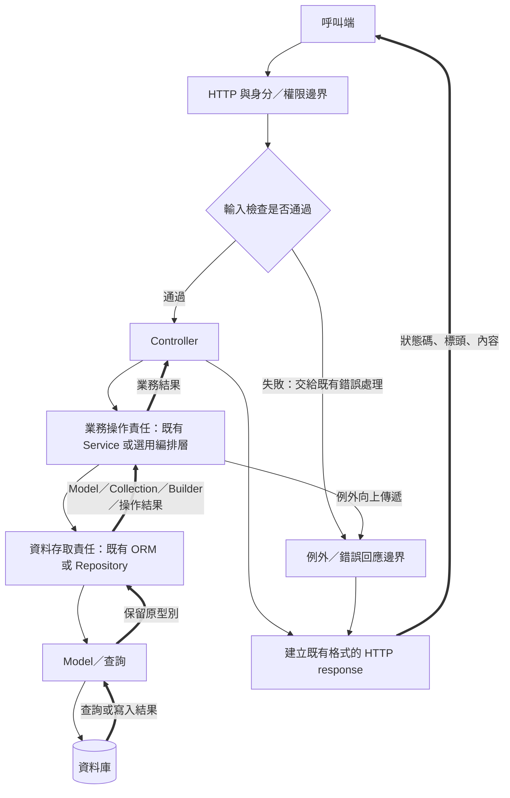
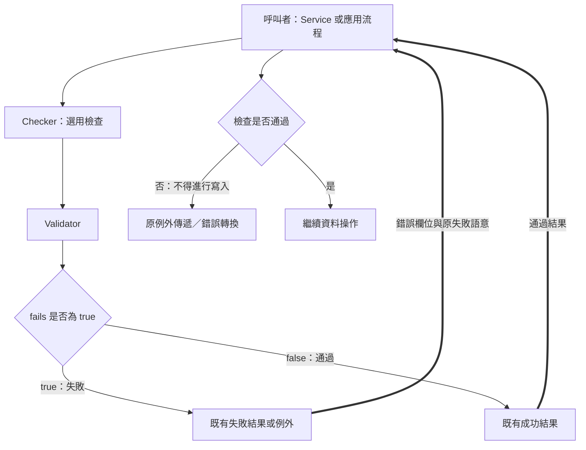
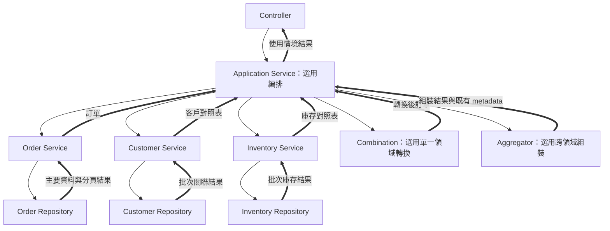
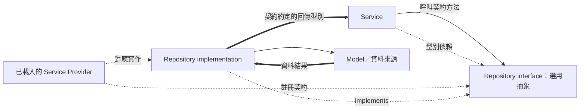
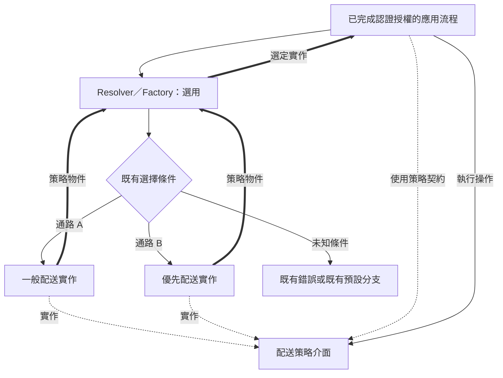

# 通用分層架構設計與重構指南

## 1. 文件目的、適用範圍與使用限制

本指南供 Laravel 或類似架構專案進行職責分析、依賴調整、最小必要重構與回歸驗證。它是可跨專案使用的設計參考及教學文件，不宣稱已檢查任何目標專案的程式碼。

閱讀本指南後，仍須查證目標專案的框架版本、套件、呼叫鏈、資料契約與測試。範例中的 Order、Inventory、Customer、類別名稱、資料表、欄位及 HTTP 回應只用於教學，不構成搬移、改名、新增資料表或修改 API 的要求。

本指南區分四種內容：

| 類型 | 用途 | 套用方式 |
| --- | --- | --- |
| 核心原則 | 輸入邊界、職責、依賴方向、資料一致性 | 檢視現有設計是否清楚，無須對應固定類別數量 |
| 選用設計 | Application Service、Repository interface、Checker、Aggregator、Strategy 等 | 有可說明的需求才採用 |
| 教學範例 | 示範一種合理實作 | 依目標專案調整，不直接複製整套配置 |
| 相容性限制 | 既有 API、資料、錯誤與副作用 | 重構預設必須保留 |

**分層架構的本質是責任與依賴，不是資料夾名稱。** 不要求建立任何固定根目錄，包括 `app/InfraStructure/`；不預設搬移 Controller、Service、Repository、Model，不預設修改 namespace，也不建立第二套平行架構。

## 2. 核心責任與選用設計

每個系統都需要可辨識的輸入與輸出邊界、業務規則，以及資料存取責任；這些責任可以由現有類別承擔，不代表必須各自建立一個目錄或類別。

| 設計 | 適合採用的情況 | 可以不新增的情況 |
| --- | --- | --- |
| Application Service／ServiceManage | 協調多個操作、交易、跨領域規則或複雜使用情境 | 單一步驟且現有 Service 已清楚承擔責任 |
| Domain／Business Service | 可重用的業務操作，或不適合放進單一實體的規則 | 現有 Model 或服務已清楚表達該規則 |
| Repository implementation | 查詢複雜、存取方式需隔離，或現有流程已透過 Repository | 簡單 ORM 操作且另建包裝沒有改善維護性 |
| Repository interface | 需要替換實作、隔離資料來源、定義穩定契約或測試替身 | 只是為每個類別機械式加一個空介面 |
| Checker | 規則需由 HTTP、CLI、Job 等入口重用，或有明確領域檢查 | 規則只屬於單一 HTTP 請求且 FormRequest 已足夠 |
| 客製 Collection | 有可重用集合操作、映射或既有型別相依 | 一次性的簡單 map，或只為類別命名而繼承 |
| Combination／Assembler | 有明確的單一領域輸出轉換 | 原資料已符合既有輸出契約 |
| CombinationManage／Aggregator | 需要合併不同領域或來源的結果 | 單一結果直接回傳 |
| Strategy／Factory／Resolver | 存在多種行為，且需依既有條件選擇 | 只有單一實作或一個可讀的簡單分支 |

選用表示「沒有需求時不新增」，不表示可以在一次重構中擅自刪掉目標專案既有介面或公開入口。先找出所有呼叫者、測試、擴充點及套件相依，再決定是否整併。

每增加一層，都應能回答：它承擔什麼責任、隔離什麼變動、如何驗證，以及為何現有類別不適合直接承擔。

## 3. 各層責任與依賴方向

| 角色 | 主要責任 | 應避免的耦合 |
| --- | --- | --- |
| HTTP／Controller | 取得已授權身分、請求資料、呼叫操作並建立既有 HTTP 回應 | 將跨領域流程、SQL 或格式映射堆在 action |
| Request／FormRequest | HTTP 輸入正規化、格式驗證、白名單與該入口的授權 | 將 HTTP Request 物件傳入可重用業務邏輯 |
| Validator | 驗證引擎、規則及錯誤資訊 | 把驗證規則直接當作資料存取結果 |
| Checker | 封裝可重用檢查，維持該功能的失敗語意 | 假定所有 Checker 都回傳相同格式 |
| Application Service／ServiceManage | 使用情境編排、操作順序、協調及明確交易邊界 | 為每個方法建立沒有額外責任的轉呼叫 |
| Domain／Business Service | 業務判斷、領域操作、透過既有資料入口取得資料 | 依賴 Controller、HTTP response 或上層流程 |
| Repository interface | 定義呼叫者真正需要的資料存取與回傳契約 | 因名稱相似便繼承未確認的基底介面 |
| Repository implementation | 查詢、載入關聯、持久化、CRUD 與必要 ORM 細節 | 反向呼叫應用流程或建立 HTTP 回應 |
| Model | 表格與連線映射、欄位、關聯、casts、序列化及既有模型行為 | 任意搬移造成 Factory、事件或關聯失效 |
| Collection | 集合操作與資料映射 | 改變集合型別、鍵值或查詢時機而未通知呼叫者 |
| Combination／Assembler | 單一領域資料的輸出轉換 | 同時查資料、做授權、改資料及送出 HTTP response |
| Aggregator／CombinationManage | 合併多份已取得資料，形成使用情境輸出 | 在逐筆組裝中隱藏大量重複查詢 |
| Provider／DI Container | 註冊介面實作、生命週期及必要的情境綁定 | 在一般業務方法中任意重綁全域共享狀態 |
| Strategy／Factory | 選擇與建立符合契約的實作 | 把平台或角色選擇誤當成認證授權 |

Application Service、ServiceManage、ServiceManager 可以表示相近的編排角色；Combination、Assembler、Resource、Presenter 也可能有職責重疊。先查實際內容與契約，不以名稱決定是否重寫。

## 4. 一般 API 請求與回應流程

下圖畫的是責任，不要求每個節點都有獨立類別。業務操作可由既有 Service 承擔；資料存取可沿用已存在的 ORM 或 Repository 邊界。

圖例：實線箭頭表示執行呼叫，粗線箭頭表示資料回傳，虛線箭頭表示編譯期依賴或 DI 對應；例外分支另以文字標記。這些是本指南的圖示約定。



若現有程式有合理且清楚的簡化路徑，不應為符合架構圖插入多餘類別；若已經有 Repository，重構也不應繞過它另建直接查詢路徑。

## 5. Controller、Request 與驗證邊界

### 5.1 分開辨識三種檢查

1. **輸入格式與正規化**：必填、型別、長度、大小寫、空值與檔案限制。
2. **認證與授權**：呼叫者是誰、是否有權執行操作、是否擁有該資源。
3. **領域規則**：庫存是否足夠、訂單是否允許轉換狀態、是否符合業務限制。

三者可以共用規則元件，但不互相取代。Strategy 選擇不構成授權；通過格式驗證也不表示資料已符合所有業務條件。

FormRequest 屬 HTTP 生命週期。沒有固定的「Service → Checker → FormRequest」呼叫鏈。若既有 Checker 只是提供規則，維持由 FormRequest 執行驗證；若它會驗證資料並回傳結果或直接拋例外，則依現有呼叫契約保留。

Laravel 支援不同的請求驗證與錯誤處理方式；採用時核對目標版本及已客製的 handler，不以框架預設回應覆蓋既有 API。[官方驗證文件](https://laravel.com/framework/docs/13.x/validation)

### 5.2 Checker 成功與失敗分支

以下只示範「status 取自 Validator::fails」的既有契約：**true 表示失敗，false 表示通過**。不能把這個語意套用到名稱相同但定義不同的結果物件。



對照時至少確認：

- Checker 是 class、trait、規則提供者，還是會拋出例外的檢查器。
- 結果的 status 語意、訊息鍵名、平坦或巢狀結構、陣列或 JSON 字串。
- 驗證失敗是否已產生副作用，錯誤由哪個邊界轉為 HTTP response。
- 輸入正規化發生時機；不得把未驗證欄位或客戶端提供的身分交給資料寫入。

## 6. Application Service 與領域操作

Application Service 負責一個使用情境：決定步驟、協調 Service、安排交易，並在需要時交給 Aggregator。領域 Service 負責可重用操作與業務判斷。

當方法只轉呼叫另一個方法，且沒有協調、交易或使用情境責任時，應先評估是否保留現有簡化路徑。不可把「每個 Controller 必須經過三個 Service」當成規範。

下圖示範需要跨領域資料的使用情境，這些額外元件均屬依複雜度選用的設計：



編排層可以接收陣列、值物件、明確參數或既有 DTO；重構時維持原參數名稱、順序、預設值與公開介面，不為採用教學名稱而改名。

## 7. Repository、依賴注入與查詢回傳

### 7.1 介面與實作

Repository interface 是資料存取契約，不是某一種固定檔名。沿用目標專案的介面名稱、namespace 及綁定方式；先確認它在程式中究竟是 interface、具體 class 或套件型別。



若採用介面，必須完成綁定並驗證 Provider 確實載入；只新增介面檔案不代表執行時可解析。Laravel 的介面綁定與自動解析方式見[官方 Container 文件](https://laravel.com/framework/docs/13.x/container)。

### 7.2 回傳型別與查詢執行時機

| 回傳 | 意義 | 重構注意事項 |
| --- | --- | --- |
| Builder | 尚可追加條件的查詢 | 不提前 get、paginate 或轉成 array |
| Eloquent Collection | 已執行查詢的一組 Model | 保留集合類別、鍵值、關聯與 map 行為 |
| 一般 Collection／array | 已整理的資料 | 不假定仍具 ORM 方法或可延後查詢 |
| Model／nullable Model | 單一實體或不存在 | 保留 null、例外及序列化契約 |
| Paginator／CursorPaginator | 含分頁狀態的結果 | 不互換頁碼、游標、總數或 URL 語意 |
| bool／int | 操作成功、影響筆數等既有語意 | 不能用一般非空判斷取代原語意 |
| 操作結果物件／陣列 | 目標系統定義的內部契約 | 逐欄位確認，不當作 HTTP response |

有些系統讓 Service 從 Repository 取得 Builder 後追加條件。這不是自動搬移所有 SQL 的理由；若要集中查詢，必須驗證篩選、排序、關聯、分頁及執行時機等價。

### 7.3 保留既有特殊開關

若目標方法存在 `skipPresenter(true)`，先查它是否切換為 Builder、其他原始結果，或另有意義。不能假定它只是控制 JSON 格式；也不能把同一行為套到每個 CRUD 方法。

若存在 `combinationType`，列出該方法實際支援的值、預設值與未知值處理；例如原樣 ORM 結果、陣列、列表或分頁都可能是不同分支。保留每個分支的型別、欄位及時機，不建立假定通用的轉換器。

帶有查詢條件、Presenter 開關或可變結果狀態的 Repository／Service，不應任意改為 singleton。現有 bind、scoped、singleton 的選擇須依實際生命週期及狀態評估，不全面統一。

## 8. Model、Collection 與資料映射

Model 的責任可能包括連線、table、primary key、key type、fillable／guarded、hidden／visible、casts、日期格式、關聯、SoftDeletes、Factory、Observer、事件與既有領域方法。不能只移動類別宣告而忽略這些行為。

客製 Collection 適用於需要重用的集合操作或既有型別契約。若目標 Model 的 newCollection 回傳自訂集合，須查明基底方法簽章、建構方式與下游型別要求；不為每個 Model 建立空的 Collection 子類別。

特別檢查：

- 集合 map 是否保留或重編鍵值；原輸出順序是否被排序、unique 或 keyBy 改變。
- 轉換過程是否觸發 lazy loading，造成額外查詢。
- 欄位是否因 toArray、日期 casts、null 或關聯序列化改變。
- Model 搬移是否真的必要；若使用者明確要求，再一起驗證 Auth Provider、Factory、關聯、事件、Job、快取及序列化資料。

## 9. Combination、Aggregator 與 HTTP 輸出

Combination／Assembler 通常處理單一領域的欄位映射；Aggregator／CombinationManage 合併多份結果。它們的回傳可以是 array、Collection、DTO 或目標系統原有結構，不強制統一為特定 data／meta 格式。

資料轉換、內部操作結果、HTTP response 是三個不同邊界：

1. 內部操作結果描述查詢或寫入發生了什麼。
2. Assembler／Aggregator 形成呼叫者需要的資料。
3. HTTP 邊界套用既有狀態碼、標頭、錯誤與 JSON 結構。

重構不得順便升級所有回應格式。保留 metadata 的鍵名、是否存在、null／空陣列、總數、頁碼、游標、前後頁 URL、日期與數值精度。

**延伸建議：** 有大量關聯資料時，先批次取得並建立 ID 對照表，再由純資料組裝器映射；可用查詢次數檢查避免 N+1。若原本已有 eager loading，先比較查詢量及結果，再決定是否改寫。

## 10. Strategy、Factory 與多實作切換

只有存在不同實作及明確選擇條件時，才考慮 Strategy、Factory、Resolver、SwitchService 或 Config。這些角色可以由現有機制承擔，不要求全部新增，也不要求使用固定名稱。



必須保留選擇參數、預設值、未知條件、授權與輸出。名稱含 Contract 的型別可能是 interface，也可能是具體入口 class；名稱含 Factory 的型別可能是選擇器、工廠介面或模型 Factory，須查實際宣告。

**延伸建議：** 需要依請求選擇策略時，優先使用明確的 resolver、物件對照表或現有情境綁定；若採全域重綁，須額外確認長駐程序與並行請求的狀態隔離。不能把選擇策略當成繞過權限檢查的入口。

## 11. 例外、交易與資料一致性

### 11.1 例外邊界

try/catch 是控制結構，不是獨立架構層，也不等於資料庫交易。

只在需要轉換既有錯誤、補償、釋放資源或適當記錄時捕捉。應保留原例外類型、訊息、code、欄位錯誤與傳遞方式；不可 catch 後回傳空結果而讓呼叫者誤認成功，也不可把例外 code 自動當成 HTTP status。

Controller、全域 handler、應用流程及領域 Service 可以各有合理的處理位置；依既有責任安排，不要求全部 Controller 都包相同 try/catch。

### 11.2 交易邊界

先列出一次使用情境內的寫入、所用連線、交易擁有者、commit／rollback 時機，以及交易外副作用，再調整責任。

同一連線的 transaction 可以包住必要的多步驟寫入；一般交易不自動提供跨連線或跨資料庫的原子性。Laravel 的交易 API 與例外處理見[官方資料庫文件](https://laravel.com/framework/docs/13.x/database)。

檔案、快取、郵件、Webhook、Event、Job 或外部服務不會因資料庫 rollback 自動還原。保持原補償順序，不把跨資源一致性宣稱為已解決。

**延伸建議：**

- 有競爭更新時，評估原資料庫支援的鎖定或原子條件更新；須在實際資料庫與隔離級別驗證。Laravel 的鎖定 API 只是機制，不能單靠方法名稱證明並行安全。[官方查詢與鎖定文件](https://laravel.com/framework/docs/13.x/queries#pessimistic-locking)
- 交易若允許重試，回呼可能多次執行；先確認外部副作用、事件及重試次數契約。
- 有明確需求時，才評估提交後派送、冪等操作、outbox 或補償流程；它們是獨立設計工作，不在純搬移重構中默默加入。

## 12. 依目標專案選擇目錄與 Namespace

先沿用既有組織方式：技術層分類、領域模組分類，或現有混合配置都可能合理。不要因架構圖使用 Application Service 就把既有 ServiceManager 改名，也不要因範例使用 RepositoryInterface 就改動其他既有介面。

只有現有配置確實無法合理承載新責任時，才提出最小範圍的目錄調整。目錄調整、namespace 改動與職責重構是不同工作；需要搬移時，說明技術理由、相依調整及相容性影響，並取得該範圍的明確需求。

禁止把參考路徑當成驗收條件，禁止為採用指南建立另一套同功能架構。類別是否需要保留或新增，以職責、契約、變動原因及測試成本判斷。

## 13. 通用 Laravel 教學範例

以下均為新編的教學範例與延伸建議，不代表任何來源專案的既有實作。為方便閱讀，同一個程式碼區塊呈現數個類別；若採用，依目標專案的載入慣例安排，無須建立同名檔案。

範例 A 展示 Laravel Adapter；範例 B、C 的組裝與策略範例可獨立理解。套用前核對目標 PHP、Laravel、資料庫及已安裝套件，不猜測第三方基底方法。

### 13.1 範例 A：建立訂單、保留驗證語意與交易

此使用情境包含扣減庫存及建立訂單，具有實際交易協調責任。Controller 擷取白名單與登入身分，Application Service 執行共用輸入檢查並安排交易，Inventory Service 判斷庫存，Repository 操作 Model。此例的 Repository 介面用於隔離 ORM 實作及替換寫入失敗的測試情境，不要求每個簡單 CRUD 都建立相同抽象。

教學模型使用 orders 與 inventory_items：前者包含 customer_id、item_id、quantity、state，後者包含 stock，兩者皆有 id 與 timestamps。這只是範例前提，不是修改目標 schema 的指令。範例假設登入識別碼即客戶識別碼，且原有 auth／Policy middleware 已完成操作授權；真實專案須沿用自己的身分對應。

行鎖是本範例的延伸示範：兩個 Repository 與交易均使用同一 DatabaseManager 的預設連線。它不證明其他連線、資料庫引擎或隔離級別具有相同保證。

```php
<?php

namespace Example\OrderCreation;

use DomainException;
use Illuminate\Auth\AuthenticationException;
use Illuminate\Contracts\Validation\Factory as ValidationFactory;
use Illuminate\Database\DatabaseManager;
use Illuminate\Database\Eloquent\Model;
use Illuminate\Http\JsonResponse;
use Illuminate\Http\Request;
use Illuminate\Support\ServiceProvider;
use Illuminate\Validation\ValidationException;
use InvalidArgumentException;

final class Order extends Model
{
    protected $table = 'orders';
    protected $fillable = ['customer_id', 'item_id', 'quantity', 'state'];
}

final class InventoryItem extends Model
{
    protected $table = 'inventory_items';
    protected $fillable = ['stock'];
}

interface OrderRepositoryInterface
{
    public function create(array $attributes): Order;
}

interface InventoryRepositoryInterface
{
    public function findForUpdate(int $itemId): ?InventoryItem;

    public function updateStock(InventoryItem $item, int $stock): void;
}

final class EloquentOrderRepository implements OrderRepositoryInterface
{
    public function __construct(private readonly DatabaseManager $databaseManager) {}

    public function create(array $attributes): Order
    {
        return Order::on($this->databaseManager->getDefaultConnection())->create($attributes);
    }
}

final class EloquentInventoryRepository implements InventoryRepositoryInterface
{
    public function __construct(private readonly DatabaseManager $databaseManager) {}

    public function findForUpdate(int $itemId): ?InventoryItem
    {
        return InventoryItem::on($this->databaseManager->getDefaultConnection())
            ->lockForUpdate()
            ->find($itemId);
    }

    public function updateStock(InventoryItem $item, int $stock): void
    {
        $item->stock = $stock;
        $item->save();
    }
}

final class OrderInputChecker
{
    public function __construct(private readonly ValidationFactory $validationFactory) {}

    public function check(array $input): array
    {
        $validator = $this->validationFactory->make($input, [
            'item_id' => ['required', 'integer', 'min:1'],
            'quantity' => ['required', 'integer', 'min:1', 'max:100'],
        ]);

        return [
            'status' => $validator->fails(),
            'errors' => $validator->errors()->toArray(),
        ];
    }
}

final class StockUnavailable extends DomainException
{
    public function __construct(public readonly int $itemId)
    {
        parent::__construct('商品不存在或庫存不足。');
    }
}

final class InventoryService
{
    public function __construct(private readonly InventoryRepositoryInterface $inventoryRepository) {}

    public function reserve(int $itemId, int $quantity): void
    {
        if ($quantity < 1) {
            throw new InvalidArgumentException('數量必須大於零。');
        }

        $item = $this->inventoryRepository->findForUpdate($itemId);

        if ($item === null || (int) $item->stock < $quantity) {
            throw new StockUnavailable($itemId);
        }

        $this->inventoryRepository->updateStock($item, (int) $item->stock - $quantity);
    }
}

final class OrderService
{
    public function __construct(private readonly OrderRepositoryInterface $orderRepository) {}

    public function create(int $customerId, int $itemId, int $quantity): Order
    {
        if ($quantity < 1) {
            throw new InvalidArgumentException('數量必須大於零。');
        }

        return $this->orderRepository->create([
            'customer_id' => $customerId,
            'item_id' => $itemId,
            'quantity' => $quantity,
            'state' => 'pending',
        ]);
    }
}

final class OrderApplicationService
{
    public function __construct(
        private readonly OrderInputChecker $orderChecker,
        private readonly InventoryService $inventoryService,
        private readonly OrderService $orderService,
        private readonly DatabaseManager $databaseManager,
    ) {}

    public function create(int $customerId, array $input): Order
    {
        $checkResult = $this->orderChecker->check($input);

        if ($checkResult['status']) {
            throw ValidationException::withMessages($checkResult['errors']);
        }

        return $this->databaseManager->connection()->transaction(function () use ($customerId, $input): Order {
            $itemId = (int) $input['item_id'];
            $quantity = (int) $input['quantity'];

            $this->inventoryService->reserve($itemId, $quantity);

            return $this->orderService->create($customerId, $itemId, $quantity);
        });
    }
}

final class OrderController
{
    public function __construct(private readonly OrderApplicationService $orderApplicationService) {}

    public function store(Request $httpRequest): JsonResponse
    {
        $customerId = $httpRequest->user()?->getAuthIdentifier();

        if ($customerId === null) {
            throw new AuthenticationException;
        }

        try {
            $order = $this->orderApplicationService->create(
                (int) $customerId,
                $httpRequest->only(['item_id', 'quantity']),
            );
        } catch (StockUnavailable $exception) {
            return new JsonResponse(['message' => $exception->getMessage()], 409);
        }

        return new JsonResponse([
            'data' => ['id' => $order->getKey(), 'state' => $order->state],
        ], 201);
    }
}

final class OrderExampleServiceProvider extends ServiceProvider
{
    public function register(): void
    {
        $this->app->bind(OrderRepositoryInterface::class, EloquentOrderRepository::class);
        $this->app->bind(InventoryRepositoryInterface::class, EloquentInventoryRepository::class);
    }
}
```

此範例的成功輸出及庫存衝突狀態碼只是示範。HTTP 請求須指定預期 JSON 回應；驗證例外由 Laravel 的既有 handler 處理。改寫真實專案時維持原 Policy、錯誤碼、JSON 欄位及 Model 行為，不直接採用範例的 201／409 或預設 handler。

應驗證的路徑：

1. 合法輸入：庫存減少、訂單建立，回傳 Order。
2. 輸入不合法：status=true，拋驗證例外，完全不寫入。
3. 庫存不足：傳遞 StockUnavailable，訂單不建立。
4. 庫存扣減後訂單寫入失敗：原例外向上傳遞，庫存與訂單一起回滾。
5. Provider 載入後可解析介面；Controller 不接受客戶端覆蓋 customer_id。

SQLite 可驗證此範例的回滾，不足以證明正式資料庫的行鎖及併發行為。

### 13.2 範例 B：訂單清單、批次查詢與跨領域組裝

上游流程採第 6 節的協調圖：Order Service 先取得一頁訂單及原分頁狀態；Application Service 擷取該頁 customer_id、item_id，再由 Customer Service 與 Inventory Service 分別批次查詢。Repository 可依既有 ORM 方式使用 whereIn 及適當索引。

不要對每筆訂單各查一次客戶與庫存，也不要在補齊關聯後重新排序或重新分頁。主查詢的可見範圍、授權與關聯條件仍須保留。

以下完整組裝器只接收已取得的資料，不執行 SQL，也不建立 HTTP response。它示範 ID 去重、關聯缺漏與原有鍵值／順序的保留：

```php
<?php

namespace Example\OrderReadModel;

final class OrderListAssembler
{
    public function relatedIds(array $orders): array
    {
        return [
            'customer_ids' => array_values(array_unique(array_column($orders, 'customer_id'))),
            'item_ids' => array_values(array_unique(array_column($orders, 'item_id'))),
        ];
    }

    public function assemble(array $orders, array $customersById, array $inventoryById): array
    {
        $rows = [];

        foreach ($orders as $rowKey => $order) {
            $rows[$rowKey] = [
                'id' => $order['id'],
                'customer_name' => $customersById[$order['customer_id']]['name'] ?? null,
                'remaining_stock' => $inventoryById[$order['item_id']]['stock'] ?? null,
            ];
        }

        return $rows;
    }
}
```

customer_name、remaining_stock 及缺漏時回傳 null 都是此新範例的契約。既有 API 若另有欄位或缺漏行為，必須沿用。組裝器完成後，原分頁 metadata 由原來的持有者一起回傳，不由組裝器自行捏造 total 或游標。

**延伸建議：** 記錄每頁的查詢數量；增加訂單筆數時，不應出現每筆固定追加數次查詢的趨勢。不同來源的讀取可能只是不同時間點的快照，清單上的庫存不能代替建立訂單時的有效性檢查。

### 13.3 範例 C：多通路策略選擇

此例存在兩種配送計價行為，才使用策略契約與 resolver。金額以最小貨幣單位整數表示，重量上限與費率皆為教學設定，不能用來覆蓋目標專案的精度、上限或計算公式。

```php
<?php

namespace Example\Delivery;

use InvalidArgumentException;

interface DeliveryStrategy
{
    public function quote(int $weightGrams): int;
}

final class StandardDelivery implements DeliveryStrategy
{
    public function quote(int $weightGrams): int
    {
        if ($weightGrams < 1 || $weightGrams > 100000) {
            throw new InvalidArgumentException('重量超出允許範圍。');
        }

        return 60 + 20 * intdiv($weightGrams + 999, 1000);
    }
}

final class PriorityDelivery implements DeliveryStrategy
{
    public function quote(int $weightGrams): int
    {
        if ($weightGrams < 1 || $weightGrams > 100000) {
            throw new InvalidArgumentException('重量超出允許範圍。');
        }

        return 100 + 30 * intdiv($weightGrams + 999, 1000);
    }
}

final class DeliveryStrategyResolver
{
    public function __construct(private readonly array $strategies)
    {
        foreach ($strategies as $strategy) {
            if (! $strategy instanceof DeliveryStrategy) {
                throw new InvalidArgumentException('策略必須實作配送契約。');
            }
        }
    }

    public function resolve(string $channel): DeliveryStrategy
    {
        return $this->strategies[$channel]
            ?? throw new InvalidArgumentException('不支援的通路。');
    }
}

function createExampleResolver(): DeliveryStrategyResolver
{
    return new DeliveryStrategyResolver([
        'web' => new StandardDelivery,
        'integration' => new PriorityDelivery,
    ]);
}
```

呼叫者先完成授權，再向 resolver 取得策略並呼叫 quote。這個物件對照表可由既有 DI 或設定來源建立，不需要為範例另建一套 Config 目錄。

1500 公克在此例依每 1000 公克向上計算為 2 單位，一般配送為 100、優先配送為 160；未支援通路會拋例外，不默默改用其他策略。這只是驗證範例，不是預設所有系統都應有相同分支。

## 14. 常見反模式與改善判斷

| 反模式 | 問題 | 改善時的限制 |
| --- | --- | --- |
| 依架構圖建立全部空層 | 增加跳轉，沒有隔離責任 | 先說明真正需要拆出的工作 |
| 同時保留兩套相同流程 | 驗證、交易或副作用可能重複 | 更新全部呼叫端，確認只執行一次 |
| 一律搬目錄或改 namespace | Factory、Auth、事件等可能失效 | 分開處理結構調整與責任重構 |
| 直接複製範例介面名稱 | 破壞既有型別與相依 | 沿用目標名稱，確認所有呼叫者 |
| 全面統一回傳 array | 遺失 Builder、Model 或分頁語意 | 逐方法固定原回傳契約 |
| 反轉 Checker 的 status | 失敗資料可能進入寫入流程 | 以既有呼叫者與測試判定語意 |
| 把 try/catch 當 transaction | 寫入失敗仍可能留下部分資料 | 查明連線、begin／commit／rollback |
| 將有狀態服務改 singleton | 條件或結果可能跨請求共用 | 驗證作用域與實例生命週期 |
| 每筆組裝時查關聯 | 查詢數量隨清單增長 | 在不改結果的前提下評估批次載入 |
| 直接複製未確認的套件基底 | 方法、型別與版本可能不符 | 閱讀已安裝實作與測試 |
| 靜默吞掉例外或回傳空值 | 呼叫者誤認操作成功 | 保留原錯誤及補償責任 |
| 一起「修正」原有業務行為 | 失去重構的可驗證範圍 | 額外功能變更另列需求與測試 |

不得複製 TODO、dd、未實作方法或明顯錯誤作為已完成的功能。interface 宣告、具語意的型別與刻意定義的例外，須依實際職責判斷，不能只因程式碼短就視為空包裝。

## 15. 行為相容性與測試要求

| 契約範圍 | 預設必須保留的項目 |
| --- | --- |
| API | URL、HTTP method、路由名稱、標頭、成功及失敗狀態 |
| Request | 欄位、參數／變數名稱、型別、正規化、預設值、驗證與錯誤語意 |
| Response | JSON 欄位、巢狀結構、空值、型別、metadata 與序列化 |
| 公開程式介面 | 方法、屬性、類別及介面名稱、參數順序、回傳型別 |
| 資料庫 | schema、欄位、連線、既有資料、查詢及影響筆數 |
| 查詢 | 排序、穩定排序條件、篩選、搜尋、關聯、頁碼／游標及總數 |
| 數值與時間 | 時區、日期格式、金額單位、精度、捨入及整數溢位處理 |
| 例外 | 類型、message、code、欄位錯誤、傳遞及轉換位置 |
| 身分權限 | 認證、資源歸屬、Policy、Middleware、CSRF、Session |
| 交易與副作用 | 連線、範圍、重試、commit／rollback、檔案及快取順序 |
| 模型生命週期 | Relation、Observer、Event、Job、SoftDeletes、Factory |
| 整合 | 對其他模組、外部服務、CLI、排程及背景程序的契約 |

先有基準，再比較重構後結果。至少覆蓋成功、輸入失敗、授權失敗、找不到資料、空結果、寫入失敗及實際存在的策略分支。若涉及分頁，檢查首尾頁、重複／缺漏、排序與 metadata；若涉及交易，確認中途失敗仍會回滾且原例外保留。

測試方式應沿用目標專案：語法與靜態檢查、容器解析、既有單元與整合測試、API 契約、必要的實際資料庫及外部整合驗證。記憶體資料庫、fake storage 或 mock 的通過結果，不能代替正式引擎的併發與跨資源驗證。

## 16. Codex 使用本架構指南的正確方式

本文件是架構設計參考。只閱讀本文件，不足以直接改動目標專案。以下階段適用於重構任務；若使用者要求文件工作，只修改文件，不自行修改應用程式。

### 第一階段：理解現況

閱讀目標 AGENTS.md 與開發規範，確認框架與套件版本、目錄、namespace、Route、Controller、Request、Service、Repository、Model、Provider、資料庫操作及既有測試。逐入口追蹤業務流程與跨模組呼叫。

只有類別名稱、import 或資料夾清單，不能證明實際執行順序、授權完成或交易存在。缺少關鍵資訊時，指出具體缺項；範圍不清楚時先確認，不自行擴成全專案重寫。

### 第二階段：建立現況與目標對照

列出目前呼叫鏈、各方法輸入輸出、失敗語意及副作用。指出有證據的耦合問題、需要拆分的責任、可直接保留的類別、必要新增的元件，以及不適用的設計。

每一項調整都應連結到可檢驗的目的；不要以「參考架構如此」作為唯一理由。

### 第三階段：最小必要重構

優先修改既有檔案、沿用現有目錄與命名空間，維持公開介面。不任意搬 Model、Controller 或其他類別，不建立平行架構、不加空包裝、不強制名稱、不重設資料庫，也不擴大未被要求的功能。

需要新增或移除介面時，同步處理所有呼叫者、Provider、測試及套件相依。若搬移 namespace 已獲明確要求，再檢查自動載入與所有隱含引用。

### 第四階段：驗證

執行必要的語法、型別、容器、API、錯誤、排序、分頁、交易與回歸測試；檢查循環相依、重複流程、查詢時機及有狀態實例。

依目標專案選擇驗證命令，不為符合本指南安裝不需要的工具。沒有實際執行的檢查，不宣稱通過；無法驗證的相依或環境，明確記錄。

### 第五階段：交付

回報重構前後差異、檔案與原因、新增／移除的責任、完成後呼叫鏈、行為相容性、已執行測試及結果，以及保留的技術債與未驗證項目。

只有使用者要求原始碼時，才提供每個指定檔案的完整內容；不使用佔位符或省略指定內容。文件中的教學程式碼不構成對目標專案的新增指令。

## 17. 重構驗收與跨專案文件檢查

- [ ] 目標功能、範圍及需要保留的契約已確認。
- [ ] 現況來自目標程式及測試，不以範例推測框架或套件行為。
- [ ] 目錄、namespace、類別與介面命名沿用目標專案。
- [ ] 每個新增層都有實際責任，沒有強制固定類別數量。
- [ ] Checker 成功／失敗語意及所有回傳型別保持一致。
- [ ] Builder 執行時機、特殊開關與既有轉換分支已逐項確認。
- [ ] Provider 已載入，綁定可解析，實例生命週期符合需求。
- [ ] 認證授權、資料範圍、排序、分頁與錯誤行為保持相容。
- [ ] 交易與副作用的責任、連線與補償時機保持相容。
- [ ] 呼叫端沒有遺漏、重複流程或反向依賴。
- [ ] 測試結果可重現，實際環境與未驗證項目分開記錄。
- [ ] 沒有以檔案盤點、公司名稱、內部系統、私有套件、專屬路徑、行號或歷史規劃推論通用架構。
- [ ] 範例、選用設計、核心原則與延伸建議已清楚區分。
- [ ] 未將教學 schema、JSON、狀態碼或類別配置套成目標專案的新要求。

文件驗收另應檢查 Markdown 連結、程式碼語法、Mermaid 語法，以及範例的成功、失敗與回滾行為。Mermaid 可使用官方 API 的 parse 功能檢查語法；語法通過與實際圖形呈現是不同檢查。[Mermaid 使用文件](https://mermaid.js.org/config/usage.html)
